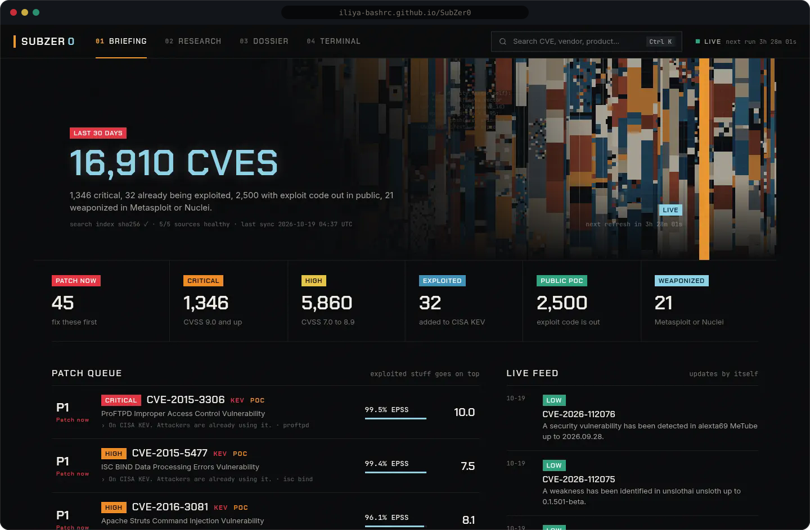
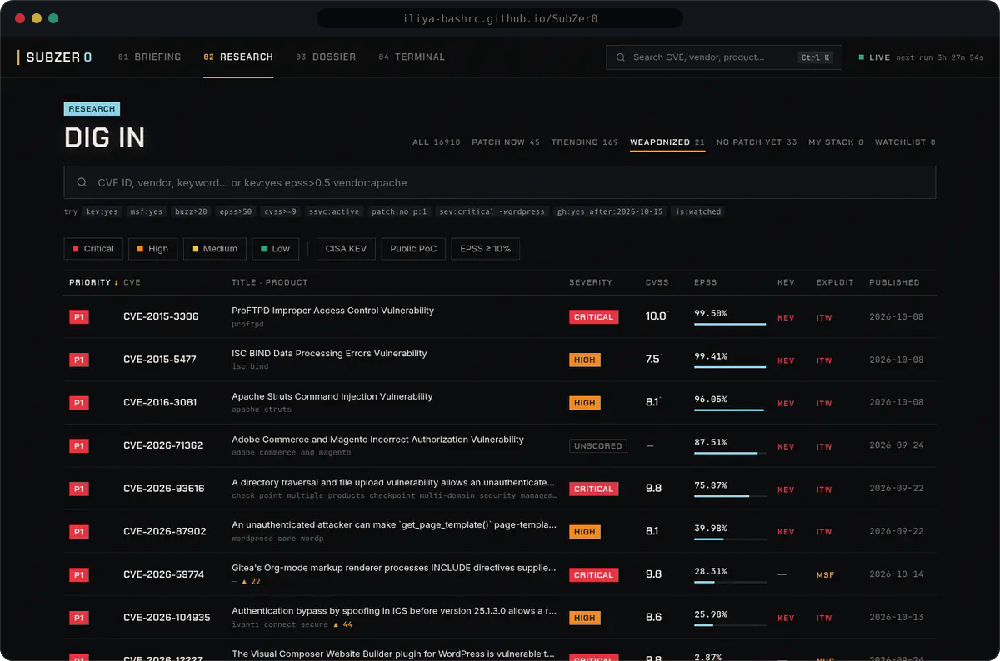
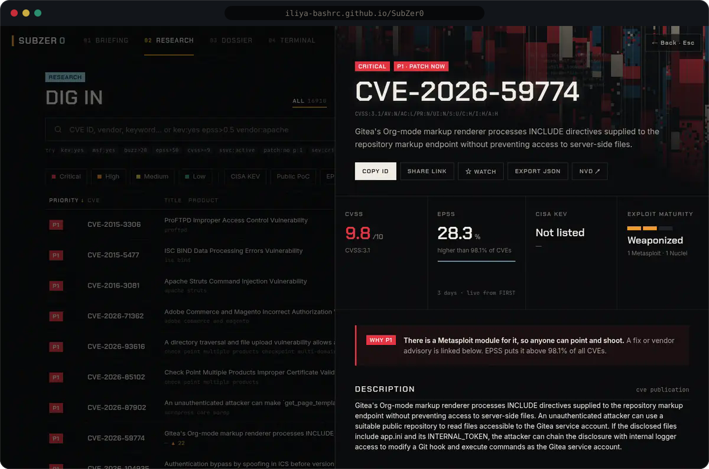
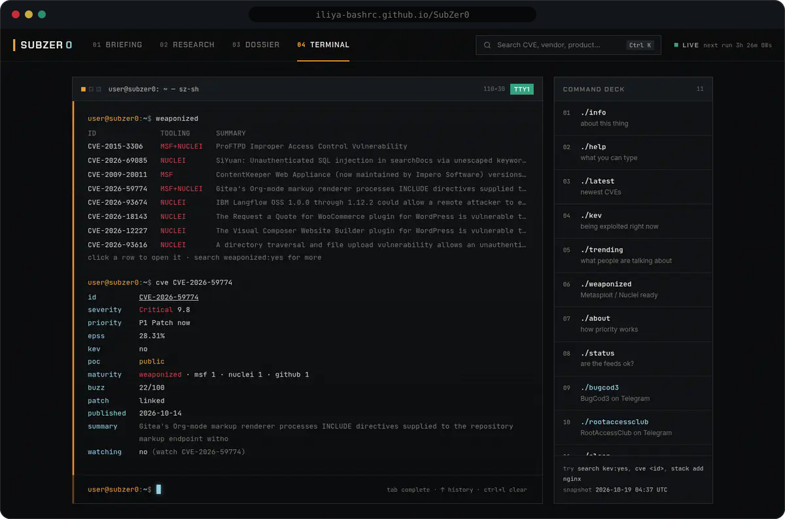
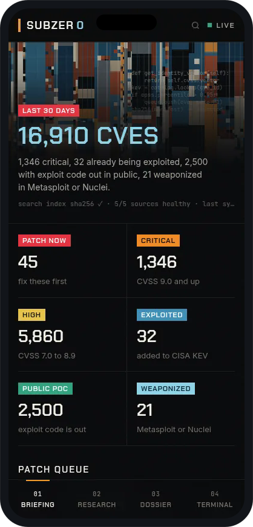
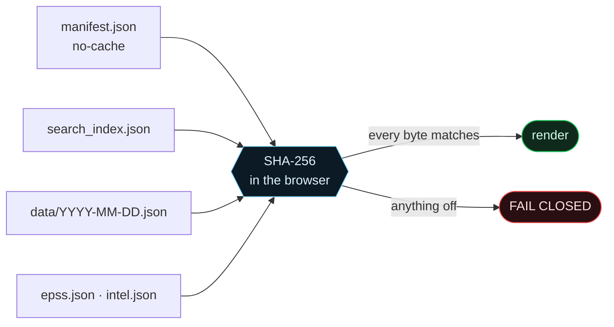
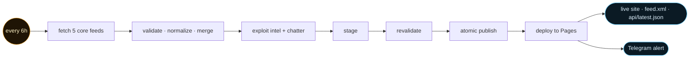
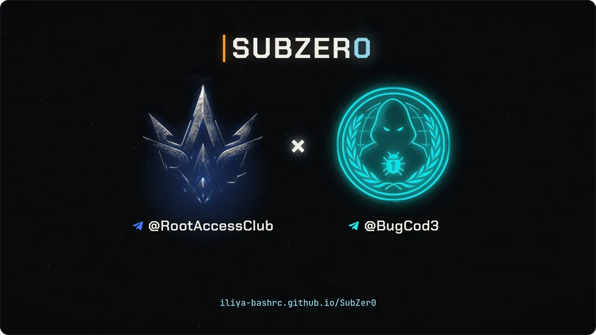

<div align="center">

<a href="https://iliya-bashrc.github.io/SubZer0/">
  
</a>

<br>

[](https://iliya-bashrc.github.io/SubZer0/)
[](https://github.com/iliya-bashrc/SubZer0/actions/workflows/checks.yml)
[](https://github.com/iliya-bashrc/SubZer0/actions/workflows/update-snapshot.yml)
[](#-trust-nothing-verify-every-byte)
[](LICENSE)

**[Open the radar](https://iliya-bashrc.github.io/SubZer0/)** ·
**[Tour](#-the-tour)** ·
**[Priority rules](#-priority-you-can-explain)** ·
**[Query language](#-query-language)** ·
**[Pipeline](#-the-machine)** ·
**[فارسی](#-فارسی)** ·
**[Telegram](#-community)**

</div>

<br>

> [!NOTE]
> **~17,000 CVEs land every 30 days. Most of them don't matter to you today. A few of them really, really do.**
> SubZer0 pulls every new CVE, cross-checks it against five core feeds and a stack of exploit intel, and hands you a short, explainable list of what to patch first — as a static site that verifies every byte before it shows you a single row.

<table>
<tr>
<td width="25%" align="center"><b>❄️ Serverless</b><br><sub>GitHub Pages + Actions.<br>No servers, no database.</sub></td>
<td width="25%" align="center"><b>🎯 Explainable</b><br><sub>Every priority comes from<br>rules you can read.</sub></td>
<td width="25%" align="center"><b>🔐 Fail-closed</b><br><sub>SHA-256 on every file,<br>checked in your browser.</sub></td>
<td width="25%" align="center"><b>🕶️ Private</b><br><sub>Your stack & watchlist<br>never leave your device.</sub></td>
</tr>
</table>

---

## 🎬 The tour

<div align="center">
<a href="https://iliya-bashrc.github.io/SubZer0/"></a>
<sub><b>01 · BRIEFING</b> — what got published, what's already being exploited, and a patch queue sorted by real-world risk.</sub>
</div>

<br>

<table>
<tr>
<td width="50%" valign="top">

<p><b>02 · RESEARCH</b><br><sub>Dig through the whole window with a tiny query language. One click for <i>Patch now</i>, <i>Trending</i>, <i>Weaponized</i> or <i>No patch yet</i>. Export what you see as CSV / JSON or share the exact view as a link.</sub></p>
</td>
<td width="50%" valign="top">

<p><b>03 · DOSSIER</b><br><sub>One page per CVE: CVSS vector, CWE, EPSS and its trend (live from FIRST), KEV due date, exploit maturity, PoCs, modules, templates, chatter and references. Every CVE has its own URL — <code>/SubZer0/cve/CVE-…</code></sub></p>
</td>
</tr>
<tr>
<td width="50%" valign="top">

<p><b>04 · TERMINAL</b><br><sub>A real-feeling shell with tab completion and history: <code>cve</code>, <code>search</code>, <code>trending</code>, <code>weaponized</code>, <code>watch</code>, <code>stack add</code>, <code>export</code>, <code>about</code> … and a couple of easter eggs: <code>bugcod3</code>, <code>rootaccessclub</code>.</sub></p>
</td>
<td width="50%" valign="top" align="center">

<p align="left"><b>📱 IN YOUR POCKET</b><br><sub>Swipe between tabs, drag with the mouse, scroll sideways on a trackpad, or hit <kbd>←</kbd> <kbd>→</kbd> / <kbd>1</kbd>–<kbd>4</kbd>. Works offline with the last verified snapshot.</sub></p>
</td>
</tr>
</table>

---

## 🎯 Priority you can explain

No black-box scores. Four tiers, plain rules — the **same rules** drive the site, the RSS feed and the Telegram alerts.

| Tier | Meaning | A CVE lands here if… |
|:---:|---|---|
| 🟥 **P1** | **Patch now** | on **CISA KEV** · SSVC exploitation = **active** · **weaponized** with CVSS ≥ 7 or EPSS ≥ 10% · public **PoC** with EPSS ≥ 10% |
| 🟧 **P2** | **This week** | CVSS ≥ 9 · CVSS ≥ 7 with a PoC or EPSS ≥ 5% · anything weaponized · automatable **and** total technical impact |
| 🟨 **P3** | **Plan it** | CVSS ≥ 7 |
| ⬜ **P4** | **Track it** | everything else |

### Exploit maturity ladder

```text
   0 ── none ─────────►  1 ── public PoC ─────────►  2 ── weaponized ─────────►  3 ── in the wild
        nothing public        code on GitHub /            Metasploit module or        CISA KEV or
                              Exploit-DB                  Nuclei template             SSVC "active"
```

PoC repos get a sanity check too — forks, bait repos and brand-new accounts are flagged instead of trusted.

---

## ⌨️ Query language

```text
kev:yes poc:yes msf:yes nuclei:yes gh:yes      # has it?
maturity>=2  epss>50  cvss>=9  buzz>20         # numbers
sev:critical  ssvc:active  auto:yes  patch:no  # flags
vendor:fortinet  after:2026-10-01  is:watched  # scope
-wordpress  "remote code execution"            # exclude · exact phrase
```

<details>
<summary><b>Keyboard shortcuts</b></summary>

| Key | Action |
|---|---|
| <kbd>/</kbd> or <kbd>Ctrl</kbd> <kbd>K</kbd> | search |
| <kbd>1</kbd> – <kbd>4</kbd> | Briefing · Research · Dossier · Terminal |
| <kbd>←</kbd> <kbd>→</kbd> | previous / next tab |
| <kbd>?</kbd> | every shortcut |

Decode / typing effects run once per visit and switch off with *reduce motion*.
</details>

---

## 🛰️ Where the signal comes from

| Layer | Source | What it tells you |
|---|---|---|
| Core | **NVD CVE API 2.0** | the CVE itself, CVSS, CWE, affected products |
| Core | **GitHub Advisory Database** | package & ecosystem advisories |
| Core | **CISA KEV** | exploited in the wild — with a due date |
| Core | **FIRST EPSS** | probability of exploitation in the next 30 days |
| Core | **Exploit-DB** | public exploit code |
| Intel | **PoC-in-GitHub** | PoC repos, with fork / bait / fresh-account warnings |
| Intel | **Metasploit · Nuclei** | weaponized: ready-to-fire modules & templates |
| Intel | **CISA Vulnrichment** | SSVC decisions, plus CISA's CVSS when NVD hasn't scored yet |
| Intel | **Bluesky · Mastodon · Reddit · Hacker News** | chatter score — what people are talking about |
| Intel | **References** | whether a fix / patch is linked |

---

## 🔐 Trust nothing. Verify every byte.

Every data file ships with a SHA-256 hash in the manifest. Your browser recomputes each one and renders **only if all of them match** — otherwise it fails closed with a loud integrity error instead of showing data it can't prove.



A cache-busting retry absorbs CDN skew between deploys.

## ⚙️ The machine



- **Fail-closed ingestion** — if a core feed is down, the last good snapshot stays live. A failed intel source keeps its last good data.
- **Atomic publish** — a broken run can never leave the live site half-updated.
- **Feeds** — RSS of *patch now* CVEs at [`/feed.xml`](https://iliya-bashrc.github.io/SubZer0/feed.xml) and a small JSON summary at [`/api/latest.json`](https://iliya-bashrc.github.io/SubZer0/api/latest.json).
- **Telegram alerts** — CVEs that just became *patch now* get posted after each refresh (`TELEGRAM_BOT_TOKEN` + `TELEGRAM_CHAT_ID` secrets; without them the step is a no-op).
- **Offline** — a service worker keeps the app shell and the last verified snapshot.

### Stack

Plain **HTML / CSS / JS** — no framework, no build step, no npm, self-hosted fonts · strict **Content-Security-Policy** (the only outside call is FIRST's EPSS API) · **Python 3** stdlib pipeline with hash-pinned CI deps · **GitHub Actions** as the backend, **GitHub Pages** as the host.

---

## 🚀 Run it locally

```bash
git clone https://github.com/iliya-bashrc/SubZer0.git && cd SubZer0
python scripts/build_site.py --out _site/SubZer0     # app + snapshot + feeds
python -m http.server -d _site 8000                  # → http://localhost:8000/SubZer0/
```

<details>
<summary><b>Rebuild the data yourself (~10 min)</b></summary>

```bash
python scripts/update_data.py --output-dir snapshot          # 5-feed refresh
python scripts/enrich_intel.py --snapshot snapshot           # exploit intel (~3 min)
python scripts/verify_data_snapshot.py --root snapshot       # integrity check
python -m unittest discover -s tests                         # tests
```
</details>

<details>
<summary><b>Repository map</b></summary>

```text
├── site/                     the app — index.html, app.js, app.css, sw.js, fonts/
├── public/snapshot/          generated, hash-verified data (don't edit by hand)
├── scripts/
│   ├── update_data.py        5-source ingestion + validation
│   ├── enrich_intel.py       exploit intel + chatter → data/intel.json
│   ├── verify_data_snapshot.py   offline integrity validator
│   ├── build_site.py         assembles _site/, writes feed.xml + api/latest.json
│   ├── notify_telegram.py    posts newly urgent CVEs
│   └── verify_pages.py       checks the live site serves the exact files
├── tests/                    pipeline, integrity, intel & workflow-security tests
└── .github/workflows/        checks.yml · update-snapshot.yml · deploy.yml
```
</details>

---

## 🌐 فارسی

<div dir="rtl">

**SubZer0** یک رادار CVE است که هر ۶ ساعت خودش آپدیت می‌شود.

همه‌ی آسیب‌پذیری‌های ۳۰ روز اخیر (حدود ۱۷ هزار مورد) را از پنج منبع اصلی جمع می‌کند: NVD، GitHub Advisory، CISA KEV، EPSS و Exploit-DB.

بعد اطلاعات اکسپلویت را رویش می‌گذارد: PoC در گیت‌هاب، ماژول Metasploit، قالب Nuclei، تصمیم SSVC و میزان بحث در شبکه‌های اجتماعی.

خروجی: یک لیست کوتاه و قابل‌توضیح — **اول چه چیزی را پچ کنی**.

- **بدون سرور** — فقط GitHub Pages و GitHub Actions
- **اولویت‌بندی شفاف** — P1 تا P4 با قوانین ساده و قابل خواندن
- **امنیت داده** — هش SHA-256 هر فایل داخل مرورگر چک می‌شود؛ اگر یک بایت هم فرق کند، چیزی نمایش داده نمی‌شود
- **حریم خصوصی** — لیست تکنولوژی‌ها و واچ‌لیست شما فقط روی دستگاه خودتان می‌ماند
- **ترمینال، جست‌وجوی پیشرفته، صفحه‌ی اختصاصی هر CVE، خروجی CSV/JSON، RSS و هشدار تلگرام**

👈 [همین حالا باز کنید](https://iliya-bashrc.github.io/SubZer0/)

</div>

---

## 📡 Community

<div align="center">



<br><br>

<a href="https://t.me/RootAccessClub"></a>
&nbsp;
<a href="https://t.me/BugCod3"></a>

<sub>Built and maintained by <b>@RootAccessClub</b> × <b>@BugCod3</b>. New CVE drops, write-ups and the occasional rant.</sub>

</div>

---

## 🤝 Contributing

Issues and PRs are welcome. CI runs the full pipeline test-suite plus snapshot validation on every PR — keep it green. Files under `public/snapshot/` are generated; please don't edit them by hand.

## ⚠️ Disclaimer

SubZer0 is built for **education and defensive research**. Don't use any information, exploit reference or technique found here against systems you don't own or don't have explicit permission to test.

<div align="center">
<br>
<sub>© 2026 @BugCod3 & @RootAccessClub — All Rights Reserved · <a href="LICENSE">Proprietary License</a></sub>
</div>
