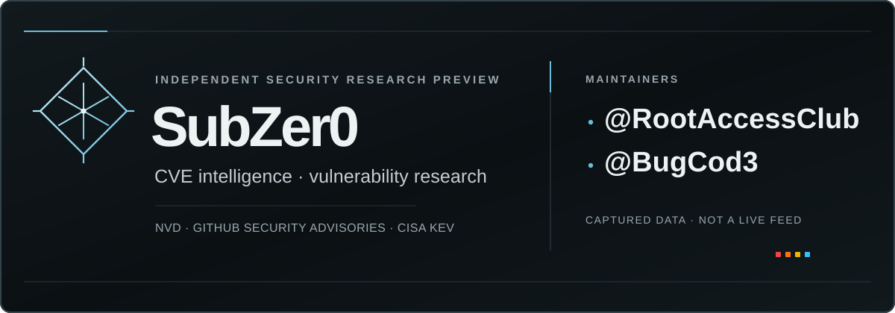

<div align="center">



# ❄️ SubZer0 — CVE Intelligence Platform

**Zero-noise vulnerability radar. Newest CVEs, real exploit signals, verified byte-for-byte.**

<a href="https://iliya-bashrc.github.io/SubZer0/"></a>

[](https://iliya-bashrc.github.io/SubZer0/)
[](https://github.com/iliya-bashrc/SubZer0/actions)
[](https://github.com/iliya-bashrc/SubZer0/actions/workflows/update-snapshot.yml)


</div>

## About

SubZer0 is a **fully static, serverless CVE radar** built for the
[@RootAccessClub](https://t.me/RootAccessClub) community. It tracks the newest
publications across five authoritative feeds, enriches every record with
exploit-intelligence signals, and guarantees every byte it shows you is the
byte the pipeline verified — SHA-256 checked in your browser before render.

- **No servers, no database, no tracking** — the entire product is a static
  export on GitHub Pages; GitHub Actions is the only "backend"
- **Fail-closed by design** — a single tampered or mismatched byte aborts the
  page instead of showing unverified data
- **Maintainers:** [@BugCod3](https://t.me/BugCod3) (security research) and
  [@RootAccessClub](https://t.me/RootAccessClub) (community & education)

<div align="center">

<a href="https://t.me/BugCod3"></a>
<a href="https://t.me/RootAccessClub"></a>

</div>

---

## What is this?

SubZer0 cuts through CVE noise. Instead of dumping 250,000 advisories at you,
it serves a rolling **30-day window** (~17,000 records) enriched with the
signals that actually matter:

| Signal | Source | Why it matters |
|---|---|---|
| CVSS severity | **NVD CVE API 2.0** | Standard impact scoring |
| Package & ecosystem advisories | **GitHub Advisory Database** | Fastest path for app dependencies |
| KEV flag | **CISA Known Exploited Vulnerabilities** | Exploited in the wild — patch now |
| EPSS probability | **FIRST** | Likelihood of exploitation in 30 days |
| Public PoC / exploit | **Exploit-DB** | Proof-of-concept code exists |

Filter by any combination — e.g. *KEV + PoC + EPSS > 0.5* — and get the handful
of CVEs that genuinely deserve your attention today.

## ⚡ Features

- **Briefing** — what got published in the last 30 days, a patch queue sorted by real-world risk, and a live feed that refreshes by itself when a new snapshot lands
- **Exploit intel** — for every CVE in the window: GitHub PoCs (with warnings for forks, bait and brand-new repos), Metasploit modules, Nuclei templates, CISA SSVC from Vulnrichment (plus CISA's CVSS when NVD hasn't scored it yet), a chatter score from Bluesky, Mastodon, Reddit and Hacker News, and whether a fix is linked. All of it rolls up into an **exploit maturity ladder**: none → public PoC → weaponized → exploited in the wild
- **Priority you can explain** — P1 *patch now*: on KEV, SSVC "active", weaponized with CVSS ≥ 7 or EPSS ≥ 10%, or a public PoC with EPSS ≥ 10%. P2 *this week*: CVSS ≥ 9, CVSS ≥ 7 with a PoC or EPSS ≥ 5%, anything weaponized, or automatable with total impact. P3: CVSS ≥ 7. P4: the rest. The same rules drive the site, the RSS feed and Telegram
- **Research** — search with a small query language: `kev:yes`, `poc:yes`, `msf:yes`, `nuclei:yes`, `gh:yes`, `buzz>20`, `patch:no`, `ssvc:active`, `auto:yes`, `maturity>=2`, `epss>50`, `cvss>=9`, `sev:critical`, `vendor:fortinet`, `after:2026-10-01`, `is:watched`, `-wordpress`, `"exact phrase"`. Views for Patch now, Trending, Weaponized and No patch yet. Export what you see as CSV or JSON (intel fields included), or copy a link to the exact view
- **My stack & watchlist** — tell it what you run and it pins those CVEs for you. Star CVEs to watch them. Both stay in your browser, nothing is sent anywhere
- **Dossier per CVE** — description, CVSS vector, CWE, EPSS with its trend over time (live from FIRST), KEV due date, affected products, references. Every CVE has its own link: `/SubZer0/cve/CVE-2026-12345`
- **Terminal** — a real-feeling shell: `cve <id>`, `search kev:yes`, `trending`, `weaponized`, `watch`, `stack add nginx`, `export`, tab completion, history
- **Moves the way you do** — swipe between tabs with a finger, drag with the mouse, scroll sideways on a trackpad, or use ← → and 1–4. Press `?` for every shortcut. Short decode/typing effects run once per visit and switch off with *reduce motion*
- **Feeds** — RSS of "patch now" CVEs at [`/feed.xml`](https://iliya-bashrc.github.io/SubZer0/feed.xml) and a small JSON summary at [`/api/latest.json`](https://iliya-bashrc.github.io/SubZer0/api/latest.json)
- **Telegram alerts** — after each refresh, CVEs that just became "patch now" can be posted to a channel (set `TELEGRAM_BOT_TOKEN` and `TELEGRAM_CHAT_ID` repo secrets; without them the step does nothing)
- **Works offline** — a service worker keeps the app shell and the last verified snapshot

## 🔐 Integrity model (the core idea)

Every data file ships with a **SHA-256 hash published in the manifest**. The
client:

1. Fetches the manifest (no-cache)
2. Fetches each artifact and computes the hash **in the browser**
3. Renders **only if every byte matches** — otherwise it fails closed with an
   explicit integrity error instead of ever showing unverified data

```
manifest.json ──► sha256 ──► search_index.json  ─┐
             ──► sha256 ──► data/YYYY-MM-DD.json ─┼──► all match? render : FAIL CLOSED
             ──► sha256 ──► epss.json             │
             ──► sha256 ──► poc_ids.json          ─┘
```

A cache-buster retry absorbs CDN/browser cache skew between deploys.

## 🔄 Fully autonomous pipeline

```
every 6h ──► fetch NVD + GHSA + CISA KEV + EPSS + Exploit-DB
         ──► validate, normalize, merge (fail-closed: any core feed down = keep last good)
         ──► add exploit intel: PoC-in-GitHub, Metasploit, Nuclei, CISA Vulnrichment,
             Bluesky / Mastodon / Reddit / HN (a failed source keeps its last good data)
         ──► stage → revalidate → atomic publish
         ──► commit ──► auto-deploy ──► live site
```

No servers, no databases, no secrets — the whole product is a **static export
on GitHub Pages** with GitHub Actions as the backend. Snapshot changes publish
atomically; a failed run never corrupts the live site.

## 🧱 Stack

- Plain HTML, CSS and JavaScript. No framework, no build step, no npm. Fonts are self-hosted
- Strict Content-Security-Policy: scripts only from the site itself, the only outside call is the FIRST EPSS API
- Python 3 pipeline (stdlib-only networking, hash-pinned CI dependencies)
- GitHub Actions for the schedule, GitHub Pages for hosting

## 🚀 Run locally

```bash
git clone https://github.com/iliya-bashrc/SubZer0.git
cd SubZer0
python scripts/build_site.py --out _site/SubZer0     # shell + snapshot + feeds
python -m http.server -d _site 8000                  # http://localhost:8000/SubZer0/
```

Regenerate the data snapshot (optional, ~10 min):

```bash
python scripts/update_data.py --output-dir snapshot          # full refresh
python scripts/enrich_intel.py --snapshot snapshot           # exploit intel (~3 min)
python scripts/verify_data_snapshot.py --root snapshot       # validate
python -m unittest discover -s tests                         # tests
```

## 📁 Repository map

```
├── site/                   # the app: index.html, app.js, app.css, sw.js, fonts/
├── public/snapshot/        # published data (manifest + day shards + index artifacts)
├── scripts/
│   ├── update_data.py          # 5-source ingestion + validation pipeline
│   ├── enrich_intel.py         # exploit intel + chatter → data/intel.json
│   ├── verify_data_snapshot.py # offline integrity validator
│   ├── build_site.py           # assembles _site/ for Pages, writes feed.xml + api/latest.json
│   ├── notify_telegram.py      # posts newly urgent CVEs after a refresh
│   └── verify_pages.py         # checks the live site serves the exact files
├── tests/                  # pipeline, integrity, site and workflow-security tests
└── .github/workflows/      # checks.yml · update-snapshot.yml · deploy.yml
```

## 🤝 Contributing

Issues and PRs are welcome. CI runs the full pipeline test-suite plus snapshot
validation on every PR — keep it green. Data files under `public/snapshot/` are
generated; don't edit them by hand.

## ⚠️ Disclaimer

SubZer0 is built for **education and defensive research**. Do not use any
information, exploit reference or technique found here against systems you do
not own or have explicit permission to test.

---

<div align="center">

© 2026 SubZer0 — by @BugCod3 & @RootAccessClub. All rights reserved.
📺 Telegram: [@RootAccessClub](https://t.me/RootAccessClub) · 💬 [@BugCod3](https://t.me/BugCod3)

</div>
